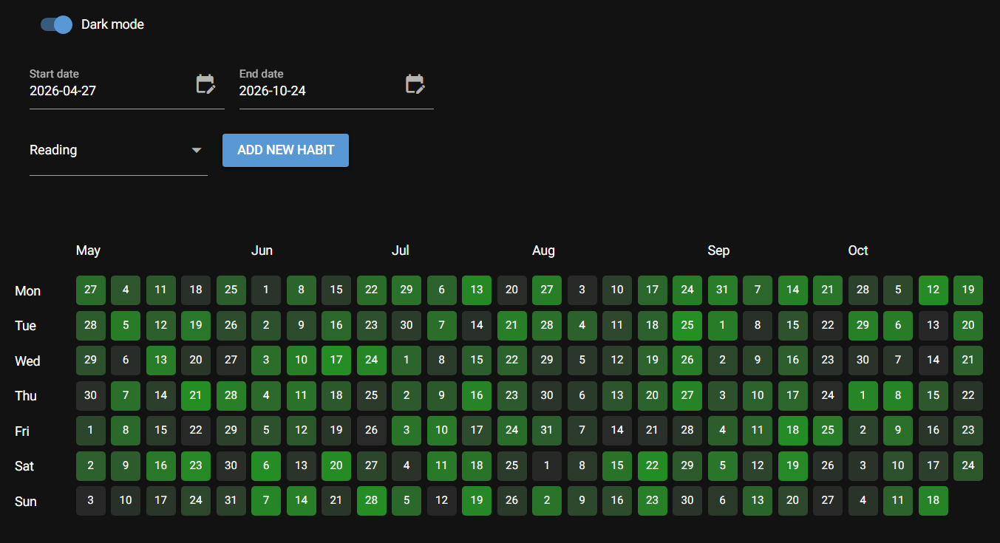

# Daily heatmap

A self-hosted minimal habit tracker built with Python, NiceGUI, and SQLite. Track daily progress in a GitHub-style heatmap.



- Create habits and switch between their heatmaps
- Choose a date range with calendar inputs (defaults to the last 180 days from current today)
- Click a day to enter a value between 0 and 1, then press Enter to save
- Toggle dark mode and collapse the controls
- Store habit data locally in SQLite

## Installation

### Method 1: Install locally

Requires Python 3.12 or later and [uv](https://docs.astral.sh/uv/). Run these commands from the repository root:

```sh
uv sync
uv run python -m heatmap.api.app
```

Open [localhost:8800/prototype-scroll](http://localhost:8800/prototype-scroll) to use the tracker.

### Method 2: Install with Docker

The Docker build requires `uv.lock`. If missing, generate it with `uv lock` first.

```sh
docker build -t heatmap .
docker run --rm -p 8000:8800 -v heatmap-data:/app/data heatmap
```

Open [localhost:8000/prototype-scroll](http://localhost:8000/prototype-scroll). The `heatmap-data` Docker volume preserves your data when the container stops.

## Configuration

Edit `configs/config.yaml` to change the database path or table name. The default database is `data/test.db`. The app creates the database and its parent directory automatically.

## Development

```sh
uv run pytest
```

## License

[MIT](LICENSE)
